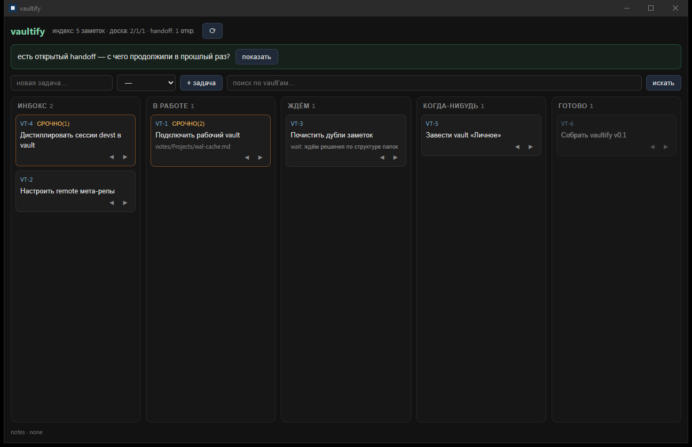
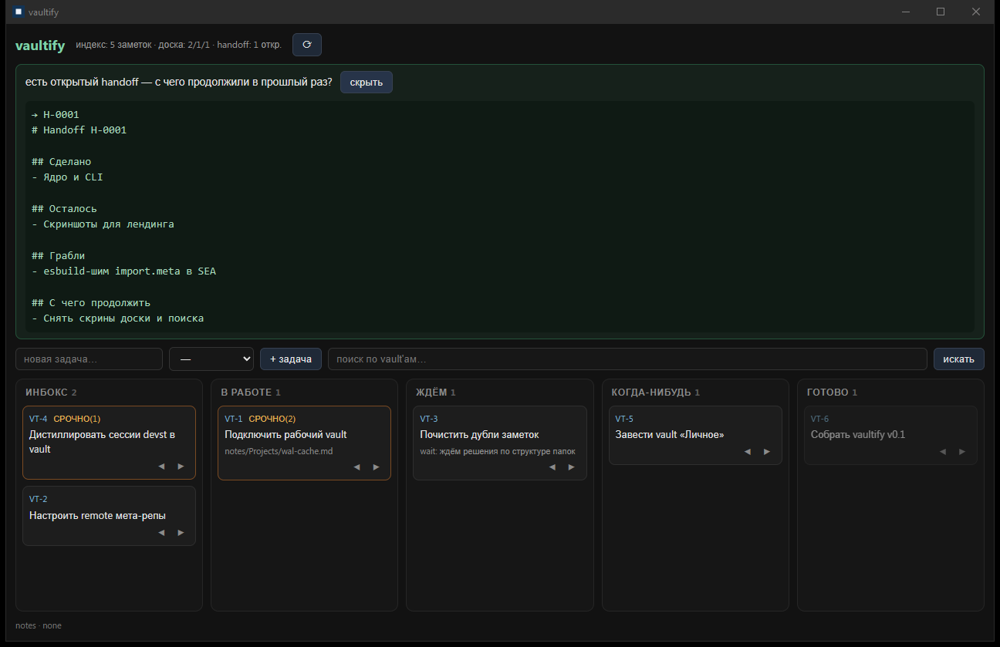
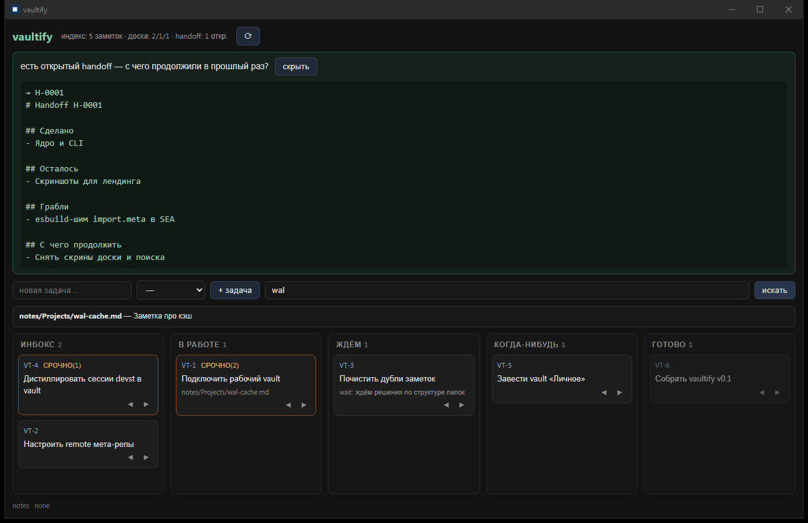

# vaultify

> [Русская версия](docs/ru/README.md)

**Shared memory for AI agents, a shared kanban board, and meta-management /
full-text search across multiple Obsidian vaults** — local-first, zero runtime
dependencies, no LLM in the core.


[](https://github.com/someguy3021/vaultify-public/actions/workflows/docs-check.yml)



| Open handoff → resume | Search across vaults |
|---|---|
|  |  |

*Screenshots show the desktop companion (Russian interface, dark theme) working
against a demo workspace: five kanban columns, the morning handoff-resume block,
and prefix search over indexed vault notes.*

## Why

When you run more than one AI coding agent, memory becomes infrastructure:

- **The amnesia problem.** Every harness keeps its own short memory. The decision
  an agent made on Tuesday is gone on Wednesday — and another harness never saw
  it at all. Each new session re-derives context from scratch.
- **The scattered-knowledge problem.** What agents do learn ends up in chat logs,
  not in your notes. The Obsidian vaults you already maintain — the canon you
  actually trust — never receive any of it.
- **The handoff problem.** Moving work from one agent (or one day) to another is
  manual: copy the state, the leftovers, the gotchas — and hope nothing is lost.

vaultify answers with a small deterministic layer between your harnesses and
your vaults: raw session memory in a git meta-repo, distilled knowledge written
into the vaults themselves, one kanban board and one search over everything.

## What's inside

| Area | Command | What it does |
|---|---|---|
| Shared memory | `vaultify memory save` · `handoff` · `resume` | A raw, append-only memory layer in the git meta-repo: session summaries and structured handoffs (done / left / gotchas / next). `resume` picks up the latest open handoff — a different harness continues where another stopped |
| Task board | `vaultify task new` · `board` · `move` … | One shared kanban over a SQLite registry: `inbox / doing / waiting / someday / done`, priorities P0–P3, links to notes; humans and agents move the same cards, every transition carries its reason |
| Vault search | `vaultify scan` · `search` | Full-text-style search over title/tags/body of every connected vault, plus tasks and memory — a prefix-inverted index on `node:sqlite`, deliberately without FTS5, rebuilt by `scan` |
| Vault registry & layouts | `vaultify vault add` · `show` · `map` | Registers any markdown folder (Obsidian-focused); layout profiles `strict / flex / single` map note types to folders, `flex` auto-detects the existing structure — the vault is never reorganized |
| Git-native sync | `vaultify status` · `sync [--dry]` | Per-vault strategies `own / shared / none` instead of a "1 vault = 1 repo" dogma; `status` reports dirty and behind vaults, `sync` does commit → pull --rebase → push per strategy |
| MCP server | `vaultify mcp` | A local MCP server (stdio JSON-RPC, zero-deps) with 8 tools — search, memory save/handoff/resume, task add/list/move, vault status — so agents of **any** harness get typed access without parsing CLI output |
| Harness integrations | `vaultify integrations install zcode\|dsh` · `doctor` | Installs the skill, slash-commands, a SessionStart hook (board + fresh memory + dirty vaults in context) and merges the MCP server into the harness config — with a backup; `doctor` verifies the wiring |
| Desktop companion | `vaultify-ui` | Tauri v2 app, board-first: five kanban columns with drag-and-drop, the morning resume block, vault search and vault statuses — the same core running in the webview |

## How it works

Two memory layers, after Karpathy's LLM Wiki pattern:

1. **Raw layer** — immutable. Session summaries (`memory/sessions/S-NNNN.md`)
   and handoffs (`memory/handoffs/H-NNNN.md`) live as plain markdown in the git
   meta-repo `<install>/home/`. Written through the CLI at the end of every
   meaningful stretch of work; never edited retroactively.
2. **Distillate** — living. Valuable conclusions become ordinary Obsidian notes
   in the user's vaults, with provenance in the frontmatter
   (`source: vaultify/S-0042`) and `[[wikilinks]]` to what already exists.

The **canon is the user's data**: the application owns only the meta-repo
(`<install>/home/`); delete it and nothing of yours is lost. And the canon stays
single — the vaults, not an app-owned wiki. Writing into a vault is
**deterministic**: the layout profile in the registry maps each note type to a
folder (unknown types fall back to an inbox folder), so the skill decides
*what* the note is, never *where* it goes.

```
USER VAULTS (the canon)                    META-REPO <install>/home/ (what the app owns)
├── ~/Notes/Work    [git: own]             ├── config.*   ← settings: vault registry,
├── ~/Notes/Life    [git: none]            │                 layout maps, git modes
└── ~/Zettel        [git: shared]          ├── tasks.db   ← SQLite task registry (kanban)
     ↑ distillate: the agent writes        ├── memory/    ← raw agent memory (markdown):
       notes per the vault's mapping       │   sessions/  ← session summaries (sources)
       (no index/topics wiki —             │   handoffs/  ← handoff records
       the canon is the vaults)            └── index.db   ← derived vault index
                                                             (rebuildable, not in git)
```

The core has **no LLM**: indexing, search, the board and sync are deterministic
code. Everything "smart" — distillation, planning, the morning flow — lives in
skills executed by the harness itself. The complete picture:
[docs/architecture/overview.md](docs/architecture/overview.md).

## Getting started

Build from source (Node ≥ 22.5 for `node:sqlite`; Windows-first):

```
pnpm install
pnpm build          # → dist/
pnpm build:sea      # → dist/sea/vaultify.exe — a single self-contained binary
```

**Where it lives (one-folder deployment):** put `vaultify.exe` anywhere you keep
tools (e.g. `D:/tools/vaultify/`) — `vaultify init` creates the data home at
`<that folder>/home/`. Everything — binaries and data — stays in one folder you can
move or back up as a whole; `VAULTIFY_HOME` relocates the data if you want it
elsewhere.

Then wire it up:

```
vaultify init                            # creates the meta-repo <install>/home/
vaultify vault add ~/Notes/Work          # registers a vault (git mode + layout auto-detected)
vaultify scan                            # builds the search index
vaultify search "quarterly goals"        # one search over all vaults, tasks and memory
vaultify integrations install zcode      # or: dsh — skill, commands, hook, MCP config merge
vaultify doctor                          # verifies the wiring
```

The desktop companion: `pnpm ui` (dev window) or `pnpm ui:build` →
`vaultify-ui.exe`. Full command reference: [docs/cli-reference.md](docs/cli-reference.md).

## Design decisions

Seventeen recorded decisions shape the tool — the full table with the rejected
alternatives lives in
[docs/decisions/design-decisions.md](docs/decisions/design-decisions.md). In brief:

| # | Decision |
|---|---|
| R1 | Toolchain like devst-public: TypeScript, zero runtime deps, Node SEA binary, Tauri UI |
| R2 | Transport: CLI (SEA) + MCP over stdio + skills/hooks — **no daemon** |
| R3 | Harnesses in v1: zcode + Claude Code, via installer adapters + `doctor` |
| R4 | No LLM in the core; distillation and planning are skills at the harness |
| R5 | The canon of knowledge is **the user's vaults** — not an SQLite canon, not an app wiki |
| R6 | Two memory layers: raw (sessions/handoffs) → distillate (vault notes with provenance) |
| R7 | Raw memory is markdown in a git meta-repo — human-readable, git history for free |
| R8 | Tasks: SQLite registry with kanban statuses `inbox/doing/waiting/someday/done` |
| R9 | All app data in one meta-repo `<install>/home/`: config, tasks.db, memory/, index.db |
| R10 | Git without dogma: per-vault strategies `own`/`shared`/`none` + `status`/`sync` |
| R11 | A flat world: one global search and one board; separation by tags and filters |
| R12 | A vault = any folder with markdown; Obsidian gets the polish (frontmatter, wikilinks) |
| R13 | No gates, no passwords — everything lies in the open, by design |
| R14 | UI v1 is board-first: kanban + the morning flow; search in the UI comes later |
| R15 | Build order: foundation → memory → UI |
| R16 | The v1 readiness criterion: the morning flow end-to-end, in one breath |
| R17 | Writing to a vault goes through layout profiles — the location is deterministic |

## References

vaultify was built on explicit ideas from four public projects — with the key
difference called out each time:

| Reference | What was borrowed |
|---|---|
| [claude-obsidian](https://github.com/AgriciDaniel/claude-obsidian) | "You capture — the AI organizes": inbox→notes, `[[wikilinks]]`, process/organize skills, the no-RAG stance. Unlike it, vaultify does not build an app-owned second brain — the canon stays in the user's vaults |
| [ai-memory](https://github.com/akitaonrails/ai-memory) | Shared memory across many harnesses, the handoff/resume protocol, the install/doctor experience. Unlike it, raw memory is markdown in a git repo, not SQLite rows |
| [Graphify](https://github.com/Graphify-Labs/graphify) | The idea of deterministic structure extraction — here with frontmatter and wikilinks instead of ASTs |
| [LLM Wiki (Karpathy)](https://gist.github.com/karpathy/442a6bf555914893e9891c11519de94f) | The two-layer pattern: immutable sources + a living, compounding distillate with provenance |

The build method itself — TypeScript with a pure core, zero runtime
dependencies, a Node SEA binary, a Tauri companion, installer + doctor — comes
from [devst](https://github.com/someguy3021/devst-public), this project's
sibling.

## Download

Prebuilt Windows binaries are attached to
[GitHub Releases](https://github.com/someguy3021/vaultify-public/releases):

- `vaultify.exe` — the CLI + MCP server (self-contained, no Node required)
- `vaultify-ui.exe` — the desktop companion (needs only WebView2, preinstalled
  on Windows 10/11)

Both are unsigned — SmartScreen will show a warning on first run. The source
code is not published; see [Status & scope](#status--scope).

## Status & scope

vaultify is a personal tooling project; this repository exists to show its
design record and documentation. To be explicit about what that means:

- The **source code is not public**; binaries are provided as-is, without warranty.
- It is not seeking users or contributors: issues may go unanswered, breaking
  changes will be unannounced, support is not promised.
- It is **Windows-first** (SEA binary + Tauri); cross-platform builds are future work.
- The CLI's output and vocabulary are in **Russian** by design — it is a personal
  tool in both senses.

## License

Documentation and assets are licensed under
[CC BY 4.0](LICENSE) — attribution: *someguy3021 / vaultify*.
